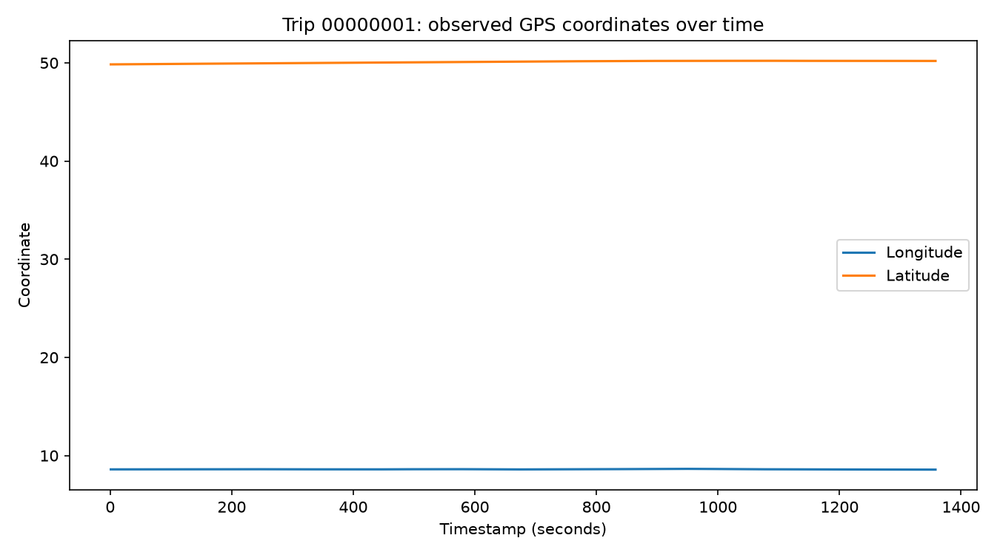
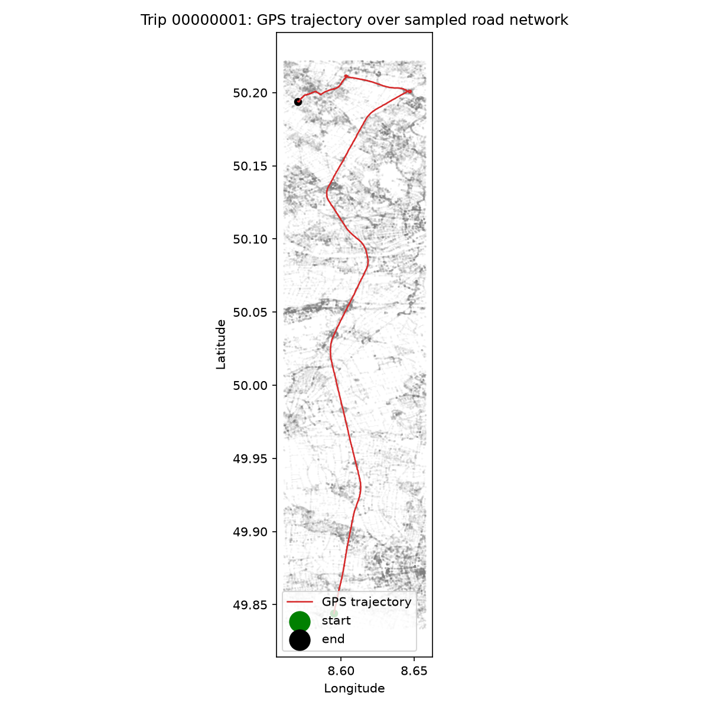
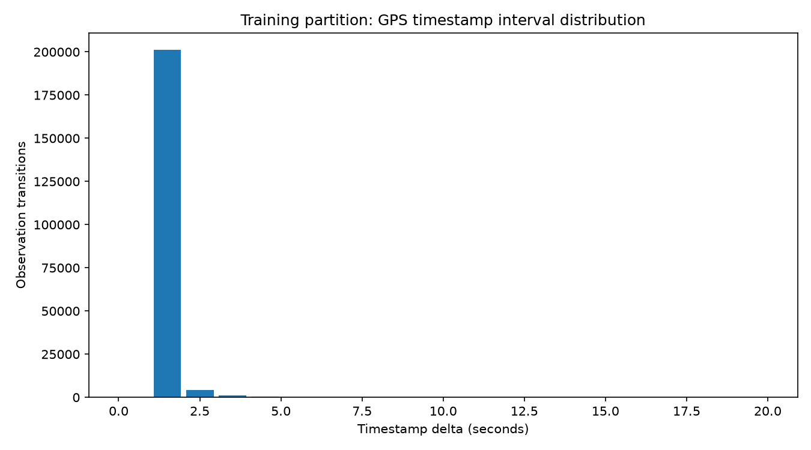
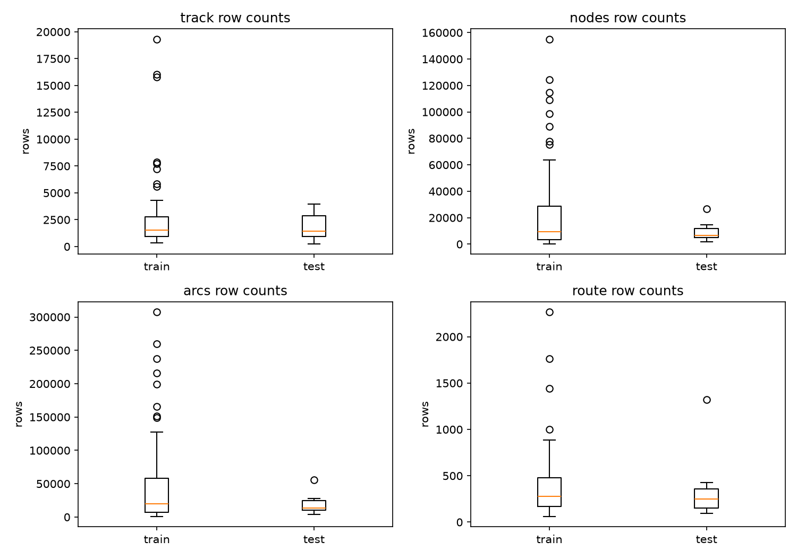

# PathSnap Dataset Explanation

> This document explains the raw dataset, observed patterns, preprocessing and transformations already applied, output artifacts, assumptions, quality findings, visualisations, and the handoff to feature engineering and model implementation.

## 1. Purpose and scope

PathSnap reconstructs vehicle trajectories by matching noisy GPS observations to a directed road network. The supplied observations are sparse or noisy snapshots of movement; they do not directly identify the road arc on which the vehicle travelled.

The correct unit of analysis is a **trip**:

- a trip has its own GPS observations;
- a trip has its own nodes and arcs;
- node and arc identifiers are local to that trip;
- identifiers must not be compared or concatenated across trips without adding `trip_id`;
- a model should learn general patterns but split training and validation by trip, not by individual GPS row.

The raw package contains 80 training trips and 10 test trips.

## 2. Directory and file organisation

```text
Student folder/
├── train/
│   ├── 00000001/
│   │   ├── 00000001.track
│   │   ├── 00000001.nodes
│   │   ├── 00000001.arcs
│   │   └── 00000001.route
│   ├── 00000002/
│   └── ...
└── student_test/
    ├── 00000000/
    │   ├── 00000000.track
    │   ├── 00000000.nodes
    │   ├── 00000000.arcs
    │   └── 00000000.route
    └── ...
```

### Partition sizes

| Partition | Trips | Track rows | Node rows | Arc rows | Route rows |
|---|---:|---:|---:|---:|---:|
| Train | 80 | 208,417 | 1,933,485 | 3,876,904 | 31,336 |
| Student test | 10 | 19,160 | 90,689 | 185,041 | 3,477 |
| **Total** | **90** | **227,577** | **2,024,174** | **4,061,945** | **34,813** |

These totals differ greatly by trip. The observed row-count ranges were:

| Partition/file | Minimum rows | Maximum rows |
|---|---:|---:|
| Train `.track` | 361 | 19,313 |
| Train `.nodes` | 299 | 155,003 |
| Train `.arcs` | 649 | 307,392 |
| Train `.route` | 59 | 2,266 |
| Test `.track` | 262 | 3,958 |
| Test `.nodes` | 1,770 | 26,635 |
| Test `.arcs` | 3,577 | 56,027 |
| Test `.route` | 95 | 1,323 |

The exact file count must therefore be verified for each trip. Fixed row limits or fixed array shapes must not be assumed.

## 3. Raw file descriptions

### 3.1 `.track`

A `.track` file contains GPS observations. It has three whitespace-separated columns and no header:

| Column | Meaning |
|---|---|
| `longitude` | Observed longitude in decimal degrees |
| `latitude` | Observed latitude in decimal degrees |
| `timestamp` | Observed time in seconds |

Example:

```text
8.595203 49.844053 1.000000
8.595294 49.844441 2.000000
8.595352 49.844883 3.000000
```

Nominally, the sampling interval is one second. This is an average property rather than a guarantee. Each observation is a noisy measurement: nearby roads can produce nearly identical coordinates, and the vehicle is not guaranteed to follow the straight segment between consecutive points.

A `.track` row does **not** contain a road arc ID. It does not correspond by row number to a `.route` row.

### 3.2 `.nodes`

A `.nodes` file contains road-network vertices. It has two whitespace-separated columns and no header:

| Column | Meaning |
|---|---|
| `longitude` | Node longitude in decimal degrees |
| `latitude` | Node latitude in decimal degrees |

The zero-based row number is the local node ID.

For example, node row 250 means node ID `250` for that trip. The same number in another trip has no relationship to node 250 in the first trip.

### 3.3 `.arcs`

An `.arcs` file contains directed road-network connections:

| Column | Meaning |
|---|---|
| `from_node_id` | Local node ID at the arc origin |
| `to_node_id` | Local node ID at the arc destination |

The file is a zero-based list, so the row number is the local arc ID:

```text
row 0: 0 -> 281
row 1: 0 -> 1
row 2: 0 -> 5
```

All arc references must be interpreted in the context of the same trip's `.nodes` file.

### 3.4 `.route`

A `.route` file contains the chronological sequence of ground-truth arc IDs for a trip:

```text
2641
64973
133948
133949
139208
```

Important properties:

- a route entry is an arc ID, not a GPS coordinate;
- route rows are an ordered arc sequence;
- consecutive route entries may represent movement through intersections and road segments;
- a route is normally shorter than a track because multiple GPS observations can occur while one arc is being traversed;
- route rows must not be aligned one-to-one by row index with track rows;
- route files remain available in the current supplied train and test directories, but route labels must not be used as if they were future GPS observations during inference.

## 4. How the components relate

The following relationships form the map-matching graph:

```text
.track
  GPS observation i
        |
        | geometric and heading candidates
        v
.arcs  ---- local row ID = arc ID ----> .route
  from_node -> to_node
        |
        v
.nodes
  node coordinates
```

For a GPS point:

1. find road arcs geometrically near the point;
2. project the point onto each candidate arc;
3. calculate distance and heading compatibility;
4. score transitions against the previous candidate;
5. choose a route that is both locally close and globally plausible in the directed graph.

The `.nodes` file supplies coordinates for the `.arcs` endpoints. The `.arcs` file supplies the directed graph. The `.route` file supplies observed arc sequences for training and evaluation. The `.track` file supplies measurements to match against that graph.

## 5. Data-quality concerns observed

### 5.1 Missing values

Missing-value analysis was performed on the complete raw training and test track partitions.

| Partition | Raw track rows | Missing track values | Missing lon | Missing lat | Missing timestamp |
|---|---:|---:|---:|---:|---:|
| Train | 208,417 | 0 | 0 | 0 | 0 |
| Student test | 19,160 | 0 | 0 | 0 | 0 |

No missing longitude, latitude or timestamp values were found in the examined raw tracks. Missing-value handling is therefore still required for robustness, but missing values are not a current observed mode in these two partitions.

### 5.2 Irregular timestamps

For every trip, `dt = timestamp[n] - timestamp[n-1]` was calculated.

| Partition | Total GPS transitions | Delta > 1 second | Delta <= 0 seconds | Approximate exactly-1-second transitions |
|---|---:|---:|---:|---:|
| Train | 208,337 | 7,286 | 0 | 201,051 |
| Student test | 19,150 | 264 | 0 | 18,886 |

The median timestamp delta was 1.0 second in both partitions. The large minimum and maximum track sizes still mean trips can include substantial differences in duration and sample count.

Exactly one-second transitions account for approximately 96.5% of raw transitions in train and 98.6% in test. A model must not assume that every observation is equally separated in time.

The upper bound for raw coordinate jumps was not used to delete observations. It was retained as a quality indicator because an isolated jump could represent multipath error or a real movement across a sparse sampling interval.

### 5.3 Node and arc reference validity

The complete manifest reports:

- 0 invalid node references in training arcs;
- 0 invalid route arc references in training routes;
- 0 invalid node references in test arcs;
- 0 invalid route arc references in test routes;
- no malformed schema errors were raised for the 90 trips.

### 5.4 Geographic and graph complexity

The trips contain very different graph sizes. This is a major quality and scalability concern:

- some trains have fewer than 2,000 nodes and arcs;
- some trips contain more than 150,000 nodes or 300,000 arcs;
- the node and arc ID spaces are trip-local;
- comparing raw coordinate distances in degrees is incorrect because a degree of longitude represents less east-west distance at high latitudes;
- candidate generation must be spatially pruned because a full GPS × segment Cartesian comparison is not practical for large trips.

### 5.5 Multipath and parallel-road ambiguity

Two or more roads can be geographically close while only one road matches the vehicle sequence. This means:

- nearest-segment matching can be wrong;
- candidate heading matters;
- previous and next observations matter;
- graph reachability matters;
- GPS velocity and timestamp gaps matter;
- globally valid routes are more reliable than independent point matches.

## 6. Assumptions influencing map matching

The following assumptions should be explicit in experiments:

1. **Trip-local graph IDs:** node and arc IDs are never compared across trips.
2. **Directed movement:** an arc is traversed from `from_node` toward `to_node`, although reverse arcs may occur in the data.
3. **Local projection:** a local origin is chosen per trip and longitude/latitude coordinates are converted to metre coordinates using a local equirectangular approximation.
4. **Candidate radius:** 75 metres is the default radius in the current implementation.
5. **Point-to-segment projection:** a candidate segment is scored using perpendicular distance and a projection fraction from 0 to 1.
6. **Heading information:** a candidate road whose bearing agrees with observed movement is preferred.
7. **Speed outlier threshold:** 70 m/s (252 km/h) is a quality flag threshold only. It does not delete observations.
8. **Time-gap threshold:** a timestamp delta greater than two seconds is labelled `is_time_gap`; it is not interpolated automatically.
9. **Route interpretation:** route IDs are used as training membership and sequence targets, not as a direct GPS row label.
10. **Candidate-radius compromise:** the 75-metre default is a starting point. It should be tuned using distance distributions and route labels.

## 7. Applied preprocessing

The following pipeline was implemented in `data_processing.ipynb` and successfully processed all 90 trips.

### 7.1 Trip manifest creation

For each trip, the manifest records:

```text
split
trip_id
track_path
nodes_path
arcs_path
route_path
n_track
n_nodes
n_arcs
n_route
start_time
end_time
non_increasing_times
missing_values
invalid_arc_node_refs
invalid_route_arc_refs
schema_valid
schema_errors
```

The manifest is stored at:

```text
processed/trip_manifest.csv
```

### 7.2 Raw parsing

Explicit dtypes and names are used for all files:

```text
.track:  lon float64, lat float64, timestamp float64
.nodes:  lon float64, lat float64
.arcs:   from_node int64, to_node int64
.route:  arc_id int64
```

Whitespace separation is used and headers are disabled because raw files contain no headers.

### 7.3 Raw-data preservation

Raw longitude, latitude and timestamp columns are retained. Derived columns are appended rather than replacing raw observations.

```text
lon_raw and lat_raw become lon/lat in the track feature table
track.timestamp remains the original time value
```

### 7.4 GPS timestamp and motion features

For each track, the pipeline creates:

| Feature | Meaning |
|---|---|
| `gps_index` | Original observation position within the trip |
| `dt` | Current timestamp minus previous timestamp |
| `is_duplicate_time` | Timestamp delta is zero or negative |
| `is_time_gap` | Timestamp delta exceeds 2 seconds |
| `is_missing` | Any raw GPS field is missing |
| `step_distance_m` | Projected Euclidean distance from previous point |
| `speed_mps` | `step_distance_m / dt` for positive dt |
| `speed_kmh` | Speed converted to km/h |
| `heading_deg` | Travel heading from previous to current point |
| `is_speed_outlier` | Speed exceeds 70 m/s |
| `quality_flag` | One of missing, duplicate, time gap, speed outlier or ok |

No plausible or outlier observation is removed from the track table. They remain available for robust models and ablation experiments.

### 7.5 Local metre projection

The pipeline uses a per-trip origin at the mean node longitude and latitude:

```text
x_m = radians(lon - lon_origin) * EARTH_RADIUS * cos(lat_origin)
y_m = radians(lat - lat_origin) * EARTH_RADIUS
```

This transformation is used for:

- segment distances;
- GPS step distances;
- speed estimates;
- point-to-arc projections;
- spatial bounding-box pruning.

### 7.6 Road-network features

For every arc, the pipeline creates:

| Feature | Meaning |
|---|---|
| `arc_id` | Local zero-based `.arcs` row index |
| `from_node` | Origin node ID |
| `to_node` | Destination node ID |
| `from_x`, `from_y` | Projected origin coordinate |
| `to_x`, `to_y` | Projected destination coordinate |
| `length_m` | Euclidean arc length |
| `bearing_deg` | Directed edge bearing |
| `mid_x`, `mid_y` | Arc midpoint |
| `min_x`, `max_x` | Bounding-box longitude direction in metres |
| `min_y`, `max_y` | Bounding-box latitude direction in metres |

### 7.7 Candidate road generation

The pipeline follows this efficient process:

1. prune arcs using projected bounding boxes and the 75-metre radius;
2. calculate the vector from arc origin to arc destination;
3. calculate the orthogonal projection fraction along the arc;
4. clamp the fraction to `[0, 1]`;
5. calculate perpendicular distance to the segment;
6. retain candidates within the radius;
7. rank candidates by perpendicular distance;
8. record the candidate rank.

Each candidate row contains:

```text
trip_id              # added through per-trip output location and summary
gps_index
dt
gps coordinates and projected coordinates
GPS speed and heading
arc_id
length_m
bearing_deg
distance_to_arc_m
projection_fraction
candidate_rank
```

The processed partition totals are:

| Partition | GPS rows | Candidate rows | GPS observations with no candidate |
|---|---:|---:|---:|
| Train | 208,417 | 3,106,041 | 8,228 |
| Test | 19,160 | 356,420 | 0 |

A candidate is not an assigned road. Candidate rows are required for a ranking model and for sequence decoding.

### 7.8 Route-derived training labels

For training trips, the route is converted into a set of route arc IDs. Candidate features receive:

```text
is_reference_route_arc
is_reference_candidate
reference_arc_id
reference_distance_m
```

The nearest candidate among route members is selected as the reference candidate for a GPS observation.

This is route membership and geometrical association, not a claim that every GPS point is exactly labelled. Long gaps or points between route arcs may require sequence and interval methods.

## 8. GPS trajectory plot

Partition: **training partition, trip `00000001`**.



This plot visualises longitude and latitude separately against timestamp. It helps reveal:

- coordinate jumps;
- sudden reversals;
- plateau-like sensor dropout;
- sampling gaps visible in timestamp separation;
- differences in how longitude and latitude vary through the trip.

## 9. Road-network and GPS visualisations

Partition: **training partition, trip `00000001`**.

The following plot overlays the GPS trajectory on a sampled view of local road arcs:



Visual interpretation is expected to include:

- GPS points near roads;
- apparent deviations caused by measurement noise;
- possible line crossings;
- points that lie between multiple candidate roads;
- urban intersections where heading and sequence are more informative than distance alone.

### 9.1 Folium geographical map

Partition: **training partition, trip `00000001`**.

Open the interactive geographical map:

[Trip 00000001 Folium map](Dataset_explnation_assets/trip_00000001_folium.html)

The map shows:

- the first 300 GPS observations as a red polyline;
- a green start marker;
- a black end marker;
- sampled local road arcs in grey;
- pan and zoom for comparison of the trajectory and road layout.

The sampled road arcs are a visualisation sample; they are not candidate filtering or route output.

## 10. Sampling and partition patterns

Partition: **all 80 training trips**.

The timestamp histogram shows the distribution of elapsed time between consecutive observations:



Observed pattern:

- most transitions have a 1-second interval;
- gaps longer than one second occur in 7,286 of 208,337 train transitions;
- gap frequency varies by trip and should be tested by trip rather than assumed uniform;
- no non-increasing timestamps were found in the raw partitions;
- large timestamp gaps should reduce confidence and increase transition uncertainty.

## 11. Trip-size patterns

Partition: **all training and test trips**.



Observed patterns:

- trip sizes vary strongly, with some trips containing more than 100 times as many nodes or arcs as the smallest trip;
- route length is much shorter than track length in general;
- a train-only route size distribution is not enough to define the test distribution;
- per-trip batching or graph-local batching is safer than merging all graphs;
- memory use is dominated by road-network storage and candidate tables.

## 12. Feature extraction rationale

| Feature family | Extracted features | Why it was chosen |
|---|---|---|
| GPS quality | dt, gap, duplicate time, missing, speed outlier | GPS dropout and irregular sampling directly affect expected movement |
| Motion | step distance, speed, heading, heading change | Vehicle movement determines whether a nearby candidate is plausible |
| Geometry | projected coordinates, candidate distance, projection fraction | Point-to-road proximity is the basic map-matching emission signal |
| Road geometry | arc length, bearing, midpoint, bounding box | Road direction and local shape distinguish parallel streets |
| Candidate | rank, route arc membership | Relative candidate quality is suitable for supervised ranking |
| Graph | from_node, to_node, directed arc ID | Valid transitions and shortest connectivity can enforce globally plausible routes |
| Labels | reference arc ID, reference distance, reference candidate | Supplied route supports supervised model training and calibration |

Derived features should be computed consistently at inference and training. The reference-route fields must be excluded as input features at inference.

## 13. Generated outputs

The complete processing run wrote:

```text
processed/
├── trip_manifest.csv
├── processing_summary.csv
├── train/
│   └── <trip_id>/
│       ├── track_features.csv
│       ├── nodes_features.csv
│       ├── arcs_features.csv
│       ├── candidate_features.csv
│       ├── route.csv
│       └── gps_reference_labels.csv
└── test/
    └── <trip_id>/
        ├── track_features.csv
        ├── nodes_features.csv
        ├── arcs_features.csv
        └── candidate_features.csv
```

### Processing summary

`processed/processing_summary.csv` confirms:

- 80/80 training trips processed;
- 10/10 test trips processed;
- 0 processing failures;
- 90/90 trips represented in the summary.

A final validation should always check:

- all expected trips exist;
- no unexpected failed processing rows exist;
- candidate tables contain valid or sentinel arc IDs;
- every training route arc ID is within the trip's local arc range;
- every track GPS index is covered by a candidate or recorded as unmatched;
- no node or arc identifier is reused across trip boundaries.

# 14. Handoff: how to continue with feature engineering

## 14.1 Use the processed candidate table as the core ML table

The next agent should treat `candidate_features.csv` as the primary training sample table:

```text
one row = one GPS observation paired with one candidate road arc
positive label = is_reference_candidate == True
negative label = is_reference_candidate == False
```

Do not train on raw GPS rows alone. A row-only model will not learn graph constraints or candidate alternatives.

## 14.2 Build these additional features next

The base tables already contain the first feature families. The next feature engineering stage should add:

### Emission features

```text
distance_to_arc_m
log(1 + distance_to_arc_m)
projection_fraction
bearing_deg
heading_difference_deg
distance_to_arc_m / candidate arc length
```

### Motion features

```text
speed_mps
speed_kmh
log(1 + speed_mps)
speed uncertainty for dt > 1
heading_deg
heading_change_deg
sin(heading_deg)
cos(heading_deg)
sin(heading_change_deg)
cos(heading_change_deg)
```

### Quality features

```text
is_time_gap
is_duplicate_time
is_missing
is_speed_outlier
quality_flag encoded categorically
candidate_count_per_gps
candidate_rank
```

### Candidate-relative features

```text
ranked distance difference from nearest candidate
minimum candidate distance
candidate density within radius
heading difference from observed heading
candidates on the same or parallel road
```

### Arc/graph features

```text
arc length
bearing sin/cos
node degree
candidate in-degree
candidate out-degree
whether the arc is a self-loop
number of outgoing and incoming arcs
```

### Sequence and transition features

```text
previous candidate arc ID
next candidate arc ID
shortest graph route between candidates
absolute graph distance minus GPS displacement
bearing change across adjacent candidates
whether the transition is reachable in the directed graph
arc transition frequency from reference routes
```

These transition features require graph paths and graph distances, which are not fully represented as flat GPS features yet.

## 14.3 Construct one candidate model dataset

For each training candidate row, the target should be:

```python
label = int(row["is_reference_candidate"])
```

Suggested protected columns:

```text
trip_id
gps_index
arc_id
reference_arc_id
reference_distance_m
is_reference_candidate
```

Suggested modelling inputs:

```text
distance_to_arc_m
projection_fraction
length_m
bearing difference
speed_mps
heading_deg
heading_change_deg
dt
is_time_gap
is_duplicate_time
is_speed_outlier
candidate_rank
node degree features
```

The following reference fields must not be included as predictive input:

```text
reference_arc_id
reference_distance_m
is_reference_candidate
route_arc membership
```

## 14.4 Split by trip

Never use random row splitting because adjacent candidate rows from the same trip are highly correlated.

A practical split is:

- 64 trips training;
- 8 trips validation;
- 8 trips test within the supplied training partition.

Alternatively, use 5-fold trip-grouped cross-validation. Each fold should preserve complete trip IDs.

Suggested geographic holdout:

- split by region if trip IDs cover multiple cities;
- verify coordinates do not overlap unintentionally;
- report both random trip split and region holdout if enough geographic diversity exists.

## 14.5 Baseline models

The first baseline should be a nearest-road rule:

```text
choose the candidate with minimum distance_to_arc_m
```

Its purpose is to quantify geometric-only performance.

The second baseline should be an XGBoost or LightGBM candidate-ranker:

```text
input: candidate and GPS features
label: is_reference_candidate
objective: ranking or binary classification
metrics: trip-level candidate accuracy and ranking quality
```

The third baseline should be an HMM or Viterbi model:

```text
states: candidate road arcs
emission score: perpendicular distance plus heading compatibility
transition score: graph reachability plus mismatch between GPS displacement and shortest graph distance
```

A candidate-ranking model should initially be evaluated independently of route decoding to separate data quality problems from sequence problems.

## 14.6 Sequence-decoding implementation

After candidate ranking is established:

1. use every GPS row to retrieve candidates;
2. create an emission cost from the ranked probability or geometric distance;
3. create transition costs from graph reachability and shortest directed route distance;
4. penalize speed-impossible transitions;
5. penalize heading inconsistency;
6. run Viterbi, Dijkstra/HMM, or dynamic programming over candidate states;
7. output the arc sequence and matched coordinates.

For long gaps, a robust model should allow reachable multi-arc transitions rather than assuming the vehicle moved as a straight line.

## 14.7 Neural model options

Once strong baselines exist, a sequence model can use:

- GRU or LSTM over a fixed GPS window;
- Transformer encoder over candidate features;
- graph neural network for directed road context;
- neural emission scorer followed by dynamic programming;
- contrastive or ranking objective on candidate arcs.

The input sequence should include motion, timestamp-gap, candidate geometry and graph-transition features. Raw latitude and longitude should be projected metre coordinates or used only in local relative features.

## 14.8 Evaluation metrics

Evaluate at least:

- point/arc precision and recall;
- candidate top-1 accuracy;
- candidate top-k recall;
- fraction of GPS observations matched to the reference route;
- route arc sequence accuracy after removing consecutive duplicates;
- route edit or longest-common-subsequence similarity;
- GPS-to-predicted-road distance;
- invalid directed-transition rate;
- performance by gap length;
- performance by candidate density;
- performance by speed and heading-change percentile;
- performance by trip and road-network size.

Primary route reconstruction metrics should consider the complete sequence, not only candidate classification accuracy.

## 14.9 Distributed ML design

The system can eventually scale trip processing and model training as follows:

```text
trip ingestion
  -> schema validation workers
  -> projected coordinate and graph workers
  -> candidate-generation workers
  -> candidate feature table
  -> ranking model training
  -> graph-constrained sequence decoder
  -> reconstructed trajectory output
```

Recommended persistence:

- partition processed files by `split/trip_id`;
- store immutable manifest and feature schemas;
- keep a separate model artifact for each candidate radius and feature version;
- avoid global node/arc integer identifiers;
- include trip-local graph metadata in each payload.

## 14.10 Final implementation checklist

The next agent should:

- [ ] load `processed/trip_manifest.csv` first;
- [ ] exclude trips marked as failed;
- [ ] load all table types per trip rather than merging raw trips globally;
- [ ] build candidate-ranking labels from reference route membership;
- [ ] remove reference-only columns from model inputs;
- [ ] split by `trip_id` before generating training labels;
- [ ] start with 75-metre candidates;
- [ ] generate a nearest-road baseline;
- [ ] train an interpretable candidate ranker;
- [ ] add directed graph transition features;
- [ ] add HMM/Viterbi or dynamic-programming decoding;
- [ ] evaluate sequence quality rather than only candidate classification;
- [ ] report normal, gap, urban-ambiguity and speed-outlier subsets separately;
- [ ] tune candidate radius using validation data only;
- [ ] rerun preprocessing with a recorded feature schema if candidate parameters change.

# 15. Key conclusion

The raw PathSnap data is trip-organized and graph-local. The most important preprocessing decisions are:

- preserve raw observations and quality flags;
- treat timestamp gaps explicitly;
- convert coordinates to metres for meaningful geometry;
- retain trip-local node and arc IDs;
- generate nearby candidate arcs instead of assuming a unique nearest road;
- avoid direct row alignment between GPS and route files;
- use reference routes for training labels and sequence evaluation;
- decode complete routes with graph constraints rather than matching each point independently.

With the 90-trip manifest, motion features, network geometry, candidate tables and route labels now in place, the project can move from data preparation to feature engineering, candidate ranking and graph-constrained trajectory reconstruction.
